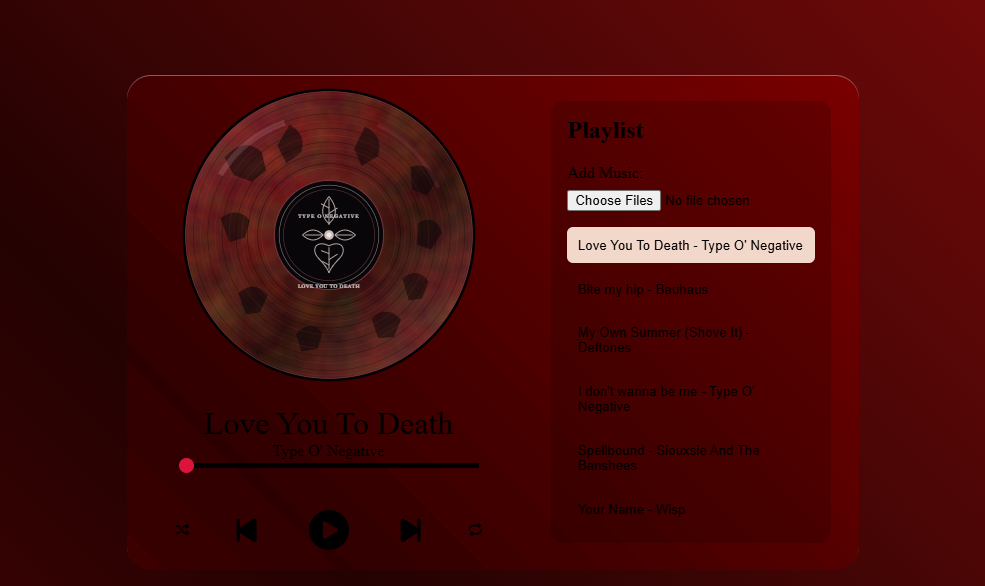
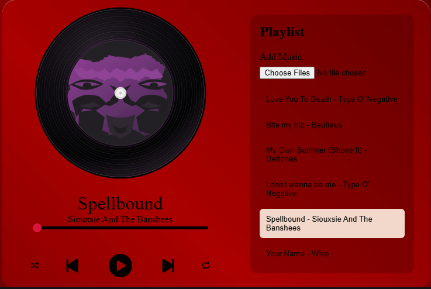

# MP3_Web_Pixel

A music player website with a dark red gothic interface MADE FOR THE PIXELL EVENT. It features a vinyl-style album cover (which doesn't spin), playback controls, a progress bar, and a playlist where you can add your own audio files. 

## Features

- Track title and artist display
- Progress bar for seeking through a track
- Controls for shuffle, previous, play/pause, next, and repeat
- Playlist panel with the current track highlighted
- Add your own MP3s to the playlist
- Sample playlist included: Type O' Negative, Bauhaus, Deftones, Siouxsie and the Banshees, and Wisp

## Getting Started

1. Download or clone the project (OR VISIT THE GITHUB PAGE)
2. Open the main HTML file in a modern web browser.
3. Click **Choose files** in the Playlist panel to add your own audio files, or select a track from the sample playlist.

## Help

If you encounter problems while running the project:
1. Page does not load correctly: Check the browser console for errors and verify that asset paths are correct.
2. Styling is missing: Ensure that the CSS files are present and linked correctly.
3. Audio does not play: Check browser audio permissions, supported audio formats, and the availability of the audio 4.source.
4. Assets are missing: Confirm that image, audio, and other resource files exist in the expected directories.
5. Changes are not appearing: Refresh the browser or clear its cached files.
6. For additional information, review the source code and the repository's issue tracker.

## License
This project is licensed under the MIT License - see the `LICENSE.md` file for details.